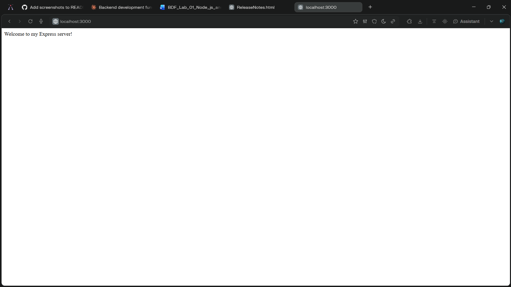
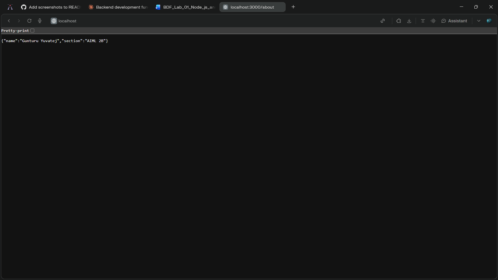
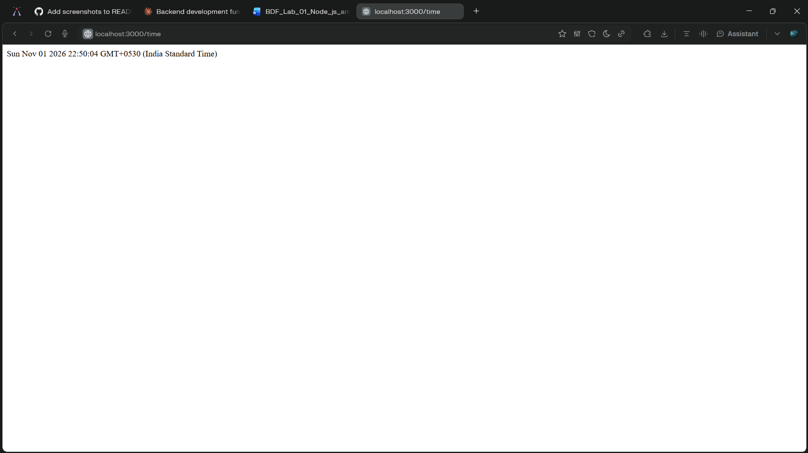
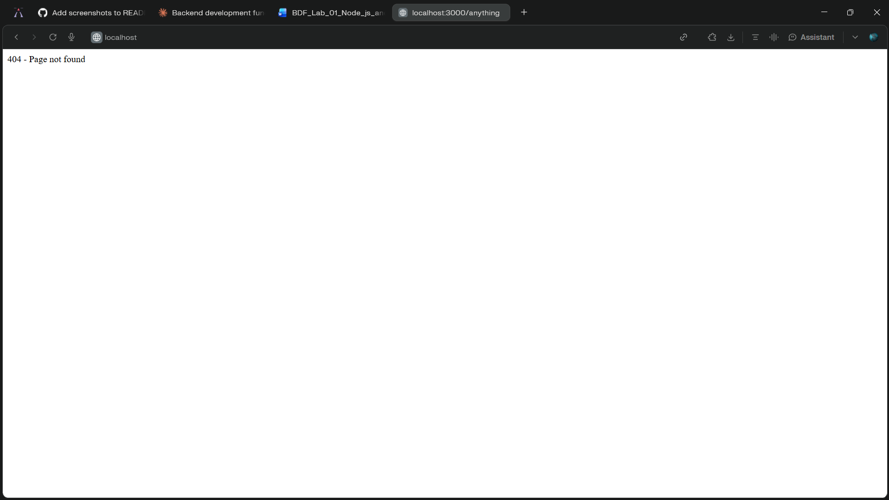
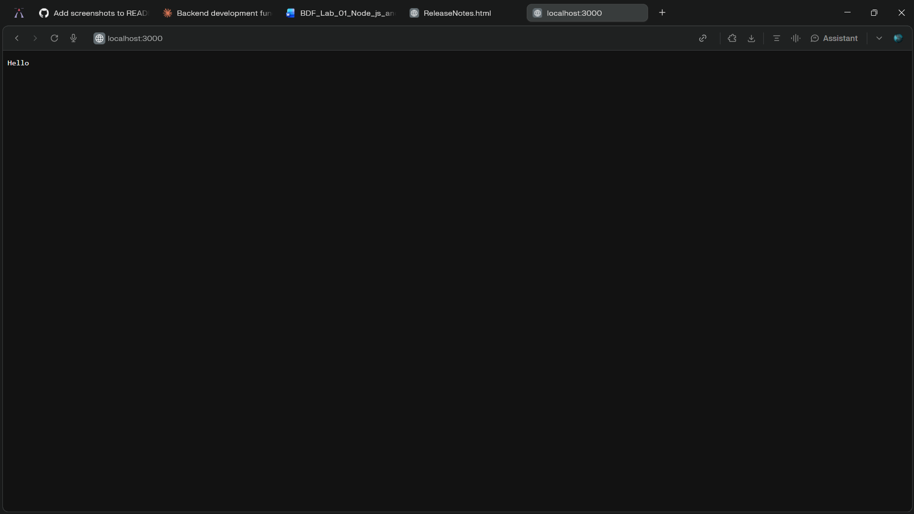

# Lab 1: Node.js and Express server

**Name:** Gunturu Yuvatej
**Registration number:** 252U1R6091
**Section:** AIML 2B

## Live link
https://YOUR-APP-NAME.onrender.com

## Objective
Set up a Node.js project and build a small web server, first with the built-in `http` module and then with Express, with three GET routes and a 404 response for unknown paths.

## How to install and run
1. Install Node.js and npm.
2. Open a terminal in this `lab-01` folder.
3. Install dependencies:

   ```bash
   npm install
   ```

4. Start the Express server:

   ```bash
   npm start
   ```

5. Open `http://localhost:3000` in your browser.

To run the plain Node.js `http` server instead, run:

```bash
npm run start:plain
```

No environment variables are required for this lab.

## Endpoints

| Method | Path | Description | Status |
|---|---|---|---|
| GET | `/` | Returns a welcome message | 200 |
| GET | `/about` | Returns name and section as JSON | 200 |
| GET | `/time` | Returns the current date and time | 200 |
| GET | Any unknown path | Returns a not-found message | 404 |

## Screenshots

### Home route (GET /) - status 200


### About route (GET /about) - status 200


### Time route (GET /time) - status 200


### Unknown route - status 404


### Plain Node.js http server


